# ATM Simulator System

A desktop ATM and bank-account simulator built with Java Swing. The application supports a multi-step account application flow and lets customers sign in with a card number and PIN to perform common ATM operations. MySQL stores customer, login, account, and transaction data.

## Features

- Customer sign-in with card number and PIN
- Three-step account application for personal, additional, and account details
- Generated card number and PIN when an account is created
- Cash deposits and withdrawals
- Fast cash withdrawals in preset amounts (Tk 100 to Tk 10,000)
- Balance enquiry, calculated from recorded deposits and withdrawals
- PIN change
- A Swing-based graphical interface

## Technology

- Java 17
- Apache NetBeans / Apache Ant project
- Java Swing
- MySQL Server and MySQL Connector/J 9.4.0
- JCalendar 1.4

## Requirements

- JDK 17 or later
- Apache NetBeans 29/30, or Apache Ant installed and available on `PATH`
- MySQL Server running locally

The required JAR files are included in `lib/`. The NetBeans project configuration references those local files.

## Database Setup

1. Start the MySQL server.
2. Open `database.sql` in MySQL Workbench and execute it. This creates the `atmsimulatorsystem` database and the tables used by the application.
3. Open `src/atm/simulator/system/Conn.java` and update the MySQL username and password in `DriverManager.getConnection(...)` to match your local MySQL account. The checked-in defaults are `root` and `123456`.
4. Ensure the connection URL points to the MySQL host and port where the database was created. The default URL, `jdbc:mysql:///atmsimulatorsystem`, connects to a local MySQL server using the driver's default port.

The database setup script creates these tables: `login`, `signup`, `signuptwo`, `signupThree`, and `bank`.

## Run the Application

### In Apache NetBeans

1. Open NetBeans and choose **File → Open Project**.
2. Select this project folder (the folder containing `build.xml`).
3. Confirm that the project is using JDK 17 or later.
4. Confirm the JAR dependencies are listed under **Project Properties → Libraries**. They should resolve to `lib/jcalendar-1.4.jar` and `lib/mysql-connector-j-9.4.0.jar`.
5. Start MySQL, complete the database setup above, then choose **Run Project**.

The configured entry point is `atm.simulator.system.Login`.

### From a terminal

Open a terminal in the project folder, then run:

```powershell
ant clean run
```

The `ant` command must be available on `PATH`. If the build succeeds but the application cannot connect to MySQL, check that MySQL is running, the database script has been executed, and the credentials in `Conn.java` are correct.

## Screenshots

These screenshots were taken from the running application on Windows 11 using sample data. They follow a customer's path through the app: signing in, opening a new account, and then using the ATM services. The image files are stored in the [`screenshots/`](screenshots) folder.

### 1. Sign In

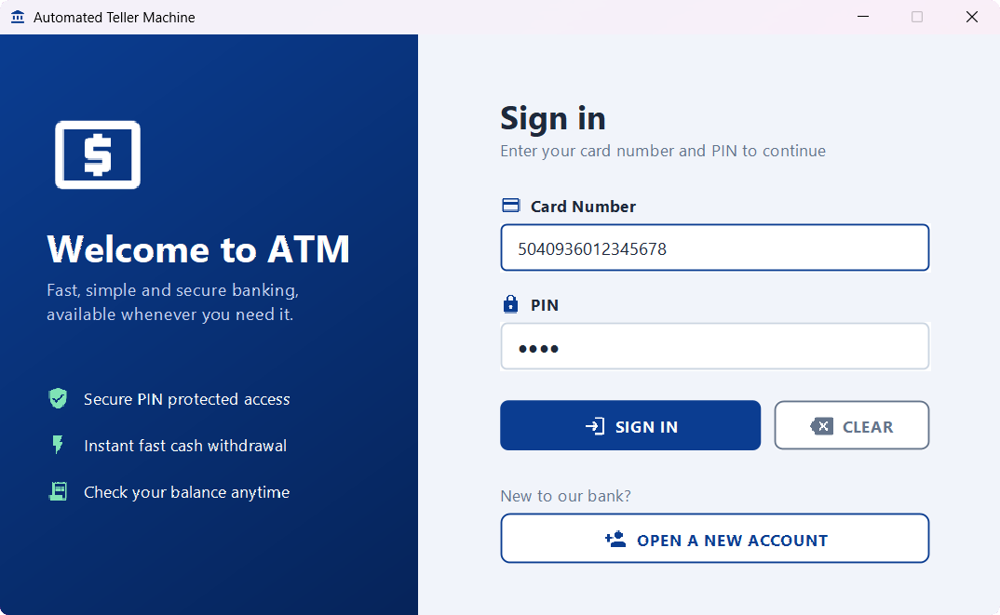

The application opens on the sign-in screen (`Login`). Customers enter their 16-digit card number and 4-digit PIN, which is masked as it is typed, then press **Sign In** or Enter. **Clear** empties both fields, and **Open a New Account** starts the account application. If the card number or PIN is wrong, an error message is shown.

### 2. Account Application: Personal Details (Step 1 of 3)

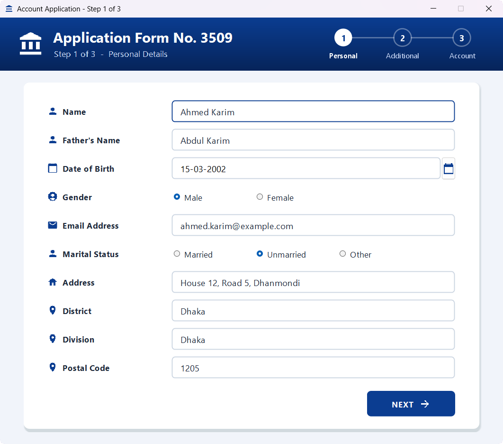

The first step of the application (`SignupOne`) is labelled with a randomly generated application form number, and the stepper in the header shows progress through the three steps. Customers enter their name, father's name, date of birth (chosen with a calendar picker), gender, email address, marital status, address, district, division and postal code. All text fields are required before the form moves on to the next step.

### 3. Account Application: Additional Details (Step 2 of 3)

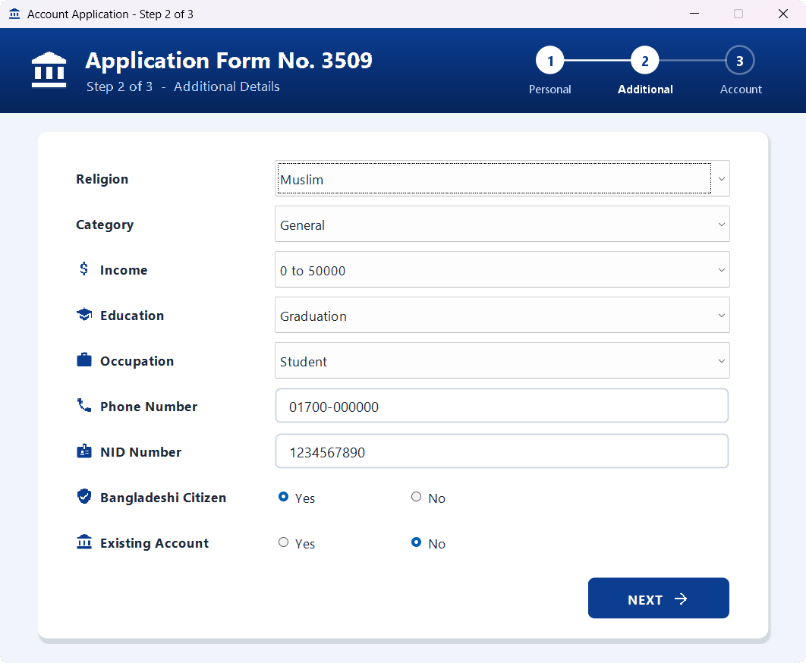

The second step (`SignupTwo`) collects religion, category, income, education and occupation from drop-down lists. Phone number and NID number are required. Customers also say whether they are a Bangladeshi citizen and whether they already have an account with the bank.

### 4. Account Application: Account Details (Step 3 of 3)

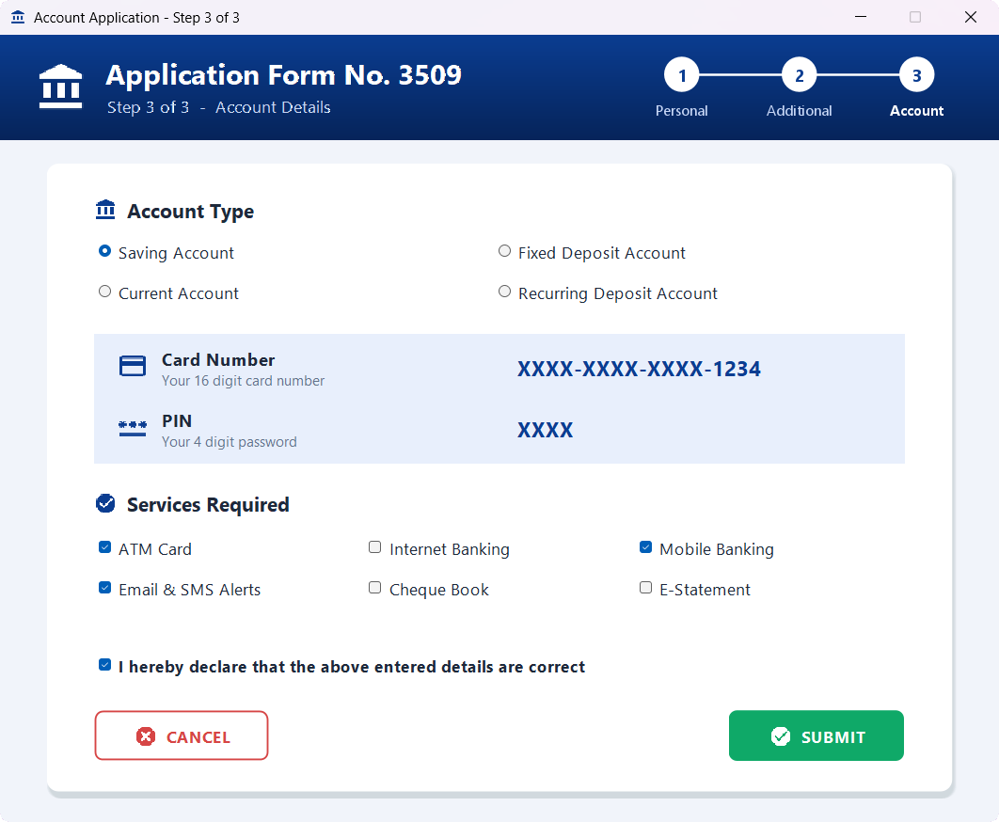

In the final step (`SignupThree`), customers choose an account type (Saving, Fixed Deposit, Current or Recurring Deposit) and the services they want: ATM card, internet banking, mobile banking, email and SMS alerts, cheque book and e-statement. They must tick the declaration before submitting. **Submit** generates a unique 16-digit card number and a 4-digit PIN, shows them in a dialog, and opens the Deposit screen so the new account can be funded. **Cancel** returns to the sign-in screen.

### 5. Main Menu

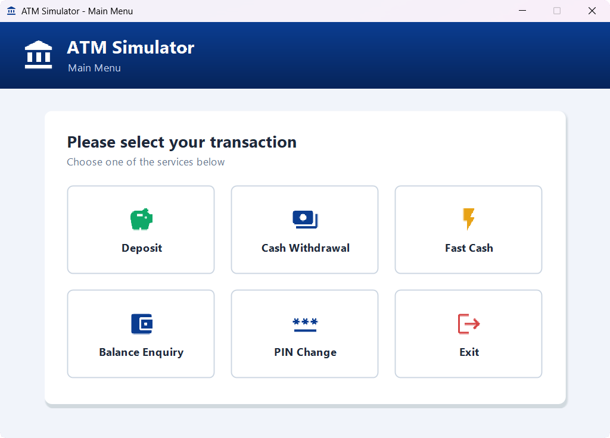

After a successful sign-in, the main menu (`Transactions`) shows every ATM service as a tile: Deposit, Cash Withdrawal, Fast Cash, Balance Enquiry, PIN Change and Exit. Each service returns to this menu when it finishes, and **Exit** closes the application.

### 6. Deposit

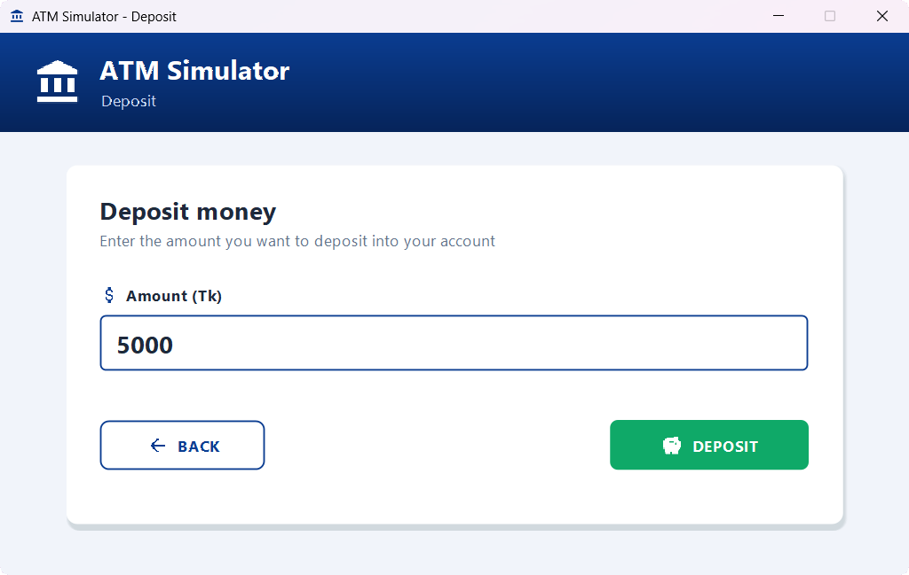

Customers enter an amount in Taka and press **Deposit**. The amount must be a positive whole number. The deposit is recorded in the `bank` table with the current date, and a confirmation message is shown. **Back** returns to the main menu without making a deposit.

### 7. Cash Withdrawal

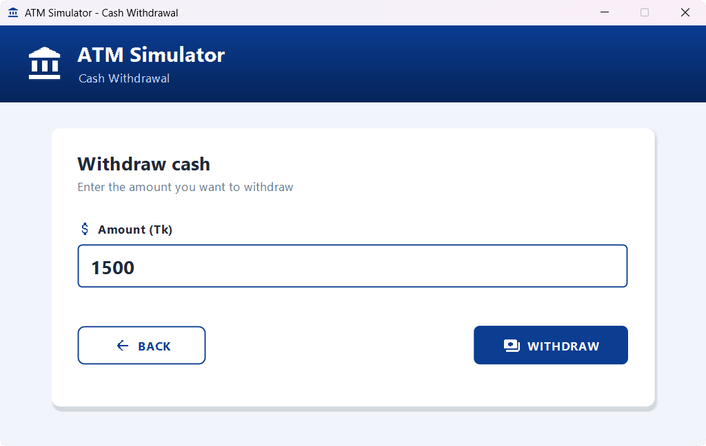

Customers can withdraw any amount (`Withdrawl`). The application checks the current balance first. If the account does not have enough money, it shows an "Insufficient balance" message and records nothing.

### 8. Fast Cash

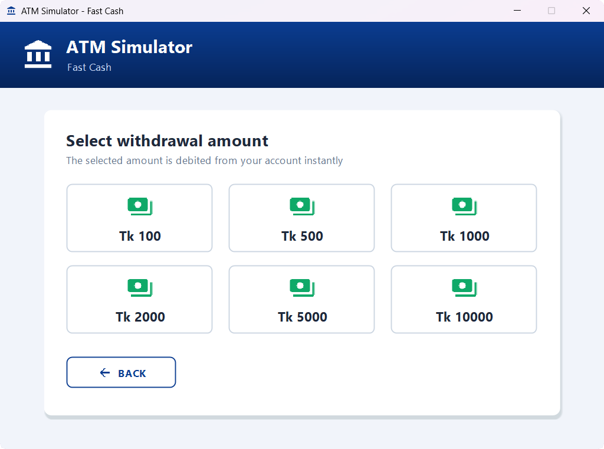

Fast Cash withdraws a preset amount in one click: Tk 100, 500, 1,000, 2,000, 5,000 or 10,000. It uses the same balance check as a regular withdrawal.

### 9. Balance Enquiry

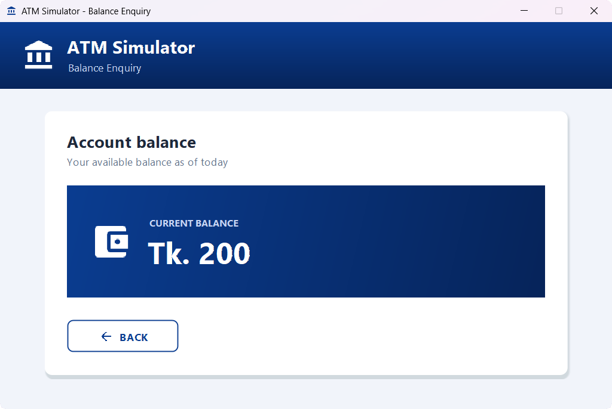

The balance enquiry screen shows the account's current balance, calculated from all recorded deposits minus withdrawals.

### 10. PIN Change

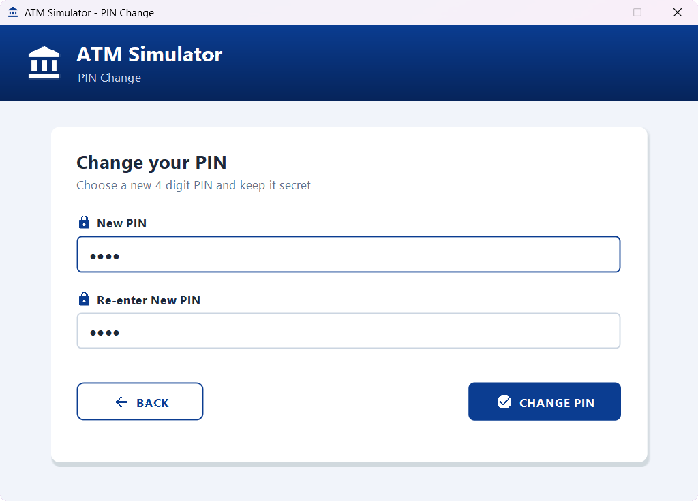

Customers enter a new PIN twice. Both entries must match and be exactly 4 digits. The new PIN is saved to both the `login` and `signupThree` tables and must be used the next time the customer signs in.

### 11. Database Schema

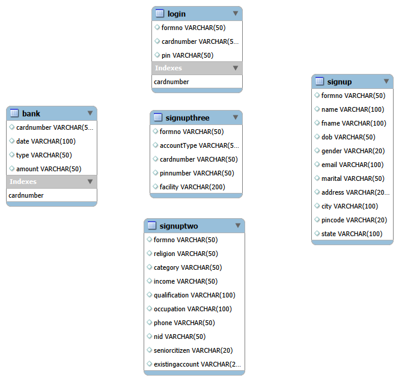

This diagram, exported from MySQL Workbench, shows the five tables in the `atmsimulatorsystem` database and their columns:

- **`signup`**, **`signuptwo`** and **`signupThree`** store the three steps of the account application. They share the same `formno`.
- **`login`** stores each card number and PIN used to sign in. `cardnumber` is unique.
- **`bank`** records every deposit and withdrawal against a card number. The balance is calculated from these rows.

The schema defines no foreign keys, so the diagram shows no relationship lines. The tables are linked only by matching `formno` and `cardnumber` values.

## Contact

**Tawyabul Islam Tamim**

Email: [tawyabulislamtamim@gmail.com](mailto:tawyabulislamtamim@gmail.com)
